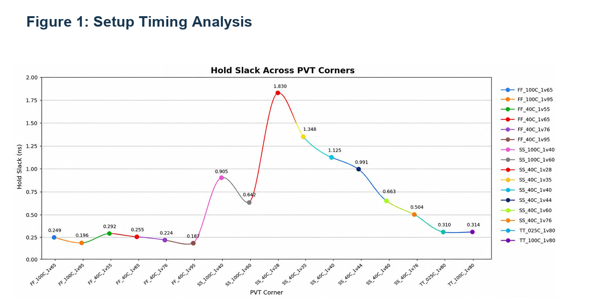
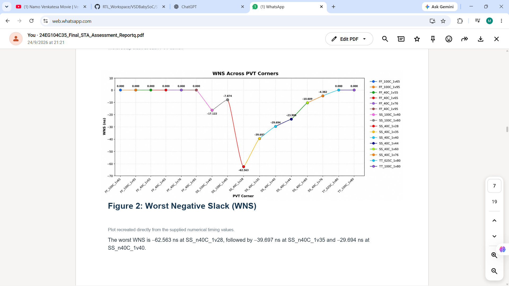
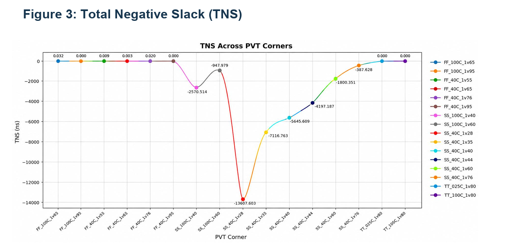
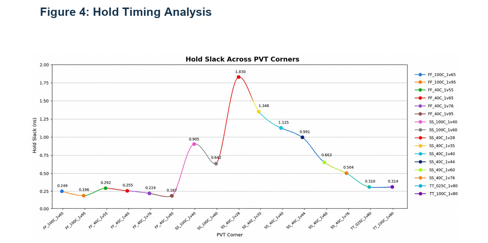

# VSDBabySoC — Multi-Corner Static Timing Analysis (STA)

## 1. Introduction

This project documents Static Timing Analysis (STA) of the VSDBabySoC design using the SKY130 HD standard-cell technology.

The objective is to evaluate the timing behavior of the design across 16 Process, Voltage, and Temperature (PVT) corners and identify the critical timing paths and conditions that cause timing violations.

The analysis covers setup timing, hold timing, Worst Negative Slack (WNS), Total Negative Slack (TNS), and critical-path investigation.

### Project Highlights

- **Design:** VSDBabySoC
- **Technology:** SKY130
- **Standard-cell library:** `sky130_fd_sc_hd`
- **Timing analysis:** OpenSTA
- **Analysis type:** Multi-corner Static Timing Analysis
- **PVT corners:** 16
- **Timing checks:** Setup and hold
- **Evidence:** Final PVT Corner Assessment Report

## 2. About VSDBabySoC

VSDBabySoC is a small System-on-Chip design integrating a RISC-V-based processor with supporting IP blocks.

The STA process evaluates the timing paths through the synthesized standard-cell logic to determine whether signals can reach their endpoints within the required timing limits.

## 3. Objectives of Static Timing Analysis

The main objectives are:

1. Evaluate setup timing across multiple PVT corners.
2. Verify hold timing requirements.
3. Identify the worst timing paths.
4. Calculate and compare WNS and TNS.
5. Study the effects of process, voltage, and temperature variations.
6. Identify corners requiring timing optimization.
7. Document the results for reproducibility and verification.

## 4. Tools and Technology

| Component | Description |
|---|---|
| Design | VSDBabySoC |
| Technology | SKY130 |
| Standard-cell library | `sky130_fd_sc_hd` |
| RTL synthesis | Yosys |
| Technology mapping | ABC, where used in the synthesis flow |
| Static timing analysis | OpenSTA |
| Timing constraints | SDC |
| Timing checks | Setup and hold |

The Liberty timing libraries provide standard-cell delay, setup, hold, and transition information used during timing analysis.

## 5. Timing Analysis Flow

The overall design flow for the timing assessment is:

1. Load the VSDBabySoC design and synthesized netlist.
2. Load the appropriate SKY130 standard-cell Liberty library.
3. Read the timing constraints and clock definitions.
4. Link the design and update timing information.
5. Run maximum-delay analysis for setup timing.
6. Run minimum-delay analysis for hold timing.
7. Record WNS, TNS, and timing-path information.
8. Repeat the analysis for all 16 PVT corners.
9. Compare results and identify the worst corner.

**Note:** The exact files and commands depend on the actual STA workspace and analysis stage. Post-route analysis additionally requires the appropriate physical database and parasitic information.

## 6. PVT Corner Analysis

PVT stands for Process, Voltage, and Temperature. These operating conditions affect standard-cell delay and overall timing behavior.

### 6.1 Process Corners

- **FF (Fast-Fast):** Fast-process corner.
- **SS (Slow-Slow):** Slow-process corner.
- **TT (Typical-Typical):** Typical-process corner.

### 6.2 Voltage

The voltage suffix identifies the operating voltage.

Examples:

- `1v28` = 1.28 V
- `1v40` = 1.40 V
- `1v65` = 1.65 V
- `1v80` = 1.80 V
- `1v95` = 1.95 V

### 6.3 Temperature

Examples:

- `n40C` = −40 °C
- `025C` = 25 °C
- `100C` = 100 °C

The complete corner name specifies the process, temperature, and voltage combination.

## 7. The 16 PVT Corners

| No. | PVT Corner | Process | Temperature | Voltage |
|---:|---|---|---:|---:|
| 1 | `FF_100C_1v65` | FF | 100 °C | 1.65 V |
| 2 | `FF_100C_1v95` | FF | 100 °C | 1.95 V |
| 3 | `FF_n40C_1v56` | FF | −40 °C | 1.56 V |
| 4 | `FF_n40C_1v65` | FF | −40 °C | 1.65 V |
| 5 | `FF_n40C_1v76` | FF | −40 °C | 1.76 V |
| 6 | `FF_n40C_1v95` | FF | −40 °C | 1.95 V |
| 7 | `SS_100C_1v40` | SS | 100 °C | 1.40 V |
| 8 | `SS_100C_1v60` | SS | 100 °C | 1.60 V |
| 9 | `SS_n40C_1v28` | SS | −40 °C | 1.28 V |
| 10 | `SS_n40C_1v35` | SS | −40 °C | 1.35 V |
| 11 | `SS_n40C_1v40` | SS | −40 °C | 1.40 V |
| 12 | `SS_n40C_1v44` | SS | −40 °C | 1.44 V |
| 13 | `SS_n40C_1v60` | SS | −40 °C | 1.60 V |
| 14 | `SS_n40C_1v76` | SS | −40 °C | 1.76 V |
| 15 | `TT_025C_1v80` | TT | 25 °C | 1.80 V |
| 16 | `TT_100C_1v80` | TT | 100 °C | 1.80 V |

## 8. Timing Metrics

### 8.1 Setup Slack

Setup timing verifies that data arrives before the required capture-clock deadline.

For the usual setup-slack convention:

`Setup Slack = Required Arrival Time − Data Arrival Time`

- Positive slack: Setup requirement is satisfied.
- Zero slack: The timing requirement is met exactly.
- Negative slack: Setup timing violation.

### 8.2 Hold Slack

Hold timing verifies that data remains stable for the required time after the capture-clock edge.

- Positive hold slack: Hold requirement is satisfied.
- Zero slack: The hold requirement is met exactly.
- Negative hold slack: Hold timing violation.

### 8.3 Worst Negative Slack (WNS)

WNS represents the worst slack among the analyzed timing paths. A negative setup WNS indicates that at least one setup path violates its timing requirement.

### 8.4 Total Negative Slack (TNS)

TNS represents the accumulated negative slack across violating paths. A more negative TNS generally indicates a greater aggregate setup-timing problem.

## 9. Multi-Corner STA Results

The following values are taken from the final PVT Corner Assessment Report.

| PVT Corner | Hold Min (ns) | Setup Max (ns) | WNS (ns) | TNS (ns) | Status |
|---|---:|---:|---:|---:|---|
| `FF_100C_1v65` | 0.249 | 4.055 | 0.000 | 0.000 | MET |
| `FF_100C_1v95` | 0.196 | 5.567 | 0.000 | 0.000 | MET |
| `FF_n40C_1v56` | 0.292 | 2.278 | 0.000 | 0.000 | MET |
| `FF_n40C_1v65` | 0.255 | 3.411 | 0.000 | 0.000 | MET |
| `FF_n40C_1v76` | 0.224 | 4.430 | 0.000 | 0.000 | MET |
| `FF_n40C_1v95` | 0.187 | 5.592 | 0.000 | 0.000 | MET |
| `SS_100C_1v40` | 0.905 | -17.122 | -17.122 | -2,599.514 | VIOLATED |
| `SS_100C_1v60` | 0.642 | -7.874 | -7.874 | -892.705 | VIOLATED |
| `SS_n40C_1v28` | 1.830 | -62.563 | -62.563 | -13,957.588 | VIOLATED |
| `SS_n40C_1v35` | 1.348 | -39.697 | -39.697 | -7,993.793 | VIOLATED |
| `SS_n40C_1v40` | 1.125 | -29.694 | -29.694 | -5,466.484 | VIOLATED |
| `SS_n40C_1v44` | 0.991 | -23.908 | -23.908 | -4,107.187 | VIOLATED |
| `SS_n40C_1v60` | 0.663 | -10.609 | -10.609 | -1,355.797 | VIOLATED |
| `SS_n40C_1v76` | 0.504 | -4.382 | -4.382 | -367.928 | VIOLATED |
| `TT_025C_1v80` | 0.310 | 1.939 | 0.000 | 0.000 | MET |
| `TT_100C_1v80` | 0.314 | 2.094 | 0.000 | 0.000 | MET |

### 9.1 Key Observations

- All six FF corners satisfy setup timing in the supplied results.
- Both TT corners satisfy setup timing.
- All eight SS corners show setup violations.
- All reported minimum hold-slack values are positive.
- The worst setup WNS is −62.563 ns.
- The most negative TNS is −13,957.588 ns.

The results identify the SS group as the primary area requiring timing-closure investigation.

## 10. Timing Analysis Results

### 10.1 Setup Timing Analysis

Setup timing analysis evaluates whether data reaches the destination register before the required capture-clock deadline across all 16 PVT corners.

The results show that all six FF corners and both TT corners meet setup timing, whereas all eight SS corners exhibit setup violations. The worst setup WNS occurs at `SS_n40C_1v28`, reaching −62.563 ns.

**Figure 1: Setup Timing Analysis**

### 10.2 Worst Negative Slack (WNS)

Worst Negative Slack (WNS) represents the worst timing slack among the analyzed paths at each PVT corner. Negative WNS indicates a setup timing violation.

The worst WNS is −62.563 ns at `SS_n40C_1v28`, followed by −39.697 ns at `SS_n40C_1v35` and −29.694 ns at `SS_n40C_1v40`.

**Figure 2: Worst Negative Slack (WNS)**

### 10.3 Total Negative Slack (TNS)

Total Negative Slack (TNS) represents the accumulated negative slack across violating timing paths.

The most negative TNS is −13,957.588 ns at `SS_n40C_1v28`. The supplied assessment reports zero TNS for the corners marked MET.

**Figure 3: Total Negative Slack (TNS)**

### 10.4 Hold Timing Analysis

Hold timing analysis verifies whether data remains stable for the required duration after the capture-clock edge.

All displayed hold-slack values are positive. The minimum is 0.187 ns at `FF_n40C_1v95`, and the maximum is 1.830 ns at `SS_n40C_1v28`.

**Figure 4: Hold Timing Analysis**

### 10.5 Overall Timing Analysis Summary

| Parameter | Result |
|---|---|
| Total PVT corners | 16 |
| Setup-violating corners | 8 |
| Worst WNS | −62.563 ns |
| Worst TNS | −13,957.588 ns |
| Minimum reported hold slack | 0.187 ns |
| Critical corner | `SS_n40C_1v28` |

The results identify setup timing in the SS corner group as the primary timing-closure concern. Further optimization should be validated by rerunning setup and hold analysis across all 16 PVT corners.
## 11. Critical Path Analysis

The supplied critical-path report identifies the following path at the worst setup corner.

| Parameter | Value |
|---|---|
| Startpoint | `core/CPU_is_addi_a3_reg` |
| Endpoint | `core/CPU_Xreg_value_a4_reg[27][30]` |
| Path group | `clk` |
| Path type | `max` |
| Critical corner | `SS_n40C_1v28` |
| Data arrival time | 71.70 ns |
| Data required time | 9.14 ns |
| Slack | Approximately −62.56 ns |
| WNS | −62.563 ns |
| TNS | −13,957.588 ns |

The large data-arrival time compared with the required time explains the negative setup slack.

### 11.1 Critical Path Cell Evidence

The supplied report lists standard-cell instances including:

- `sky130_fd_sc_hd__dfxtp_1`
- `sky130_fd_sc_hd__nor2_1`
- `sky130_fd_sc_hd__nand2_1`
- `sky130_fd_sc_hd__inv_2`
- `sky130_fd_sc_hd__xor2_1`
- `sky130_fd_sc_hd__a21oi_1`
- `sky130_fd_sc_hd__o21ai_1`
- `sky130_fd_sc_hd__fa_1`
- `sky130_fd_sc_hd__a21o_1`

The reported path contains multiple logic and full-adder stages. This provides evidence for further critical-path investigation, but the report alone does not establish that any one cell is the root cause.

## 12. Timing-Closure Plan

The next steps recommended by the assessment are:

1. Investigate `SS_n40C_1v28` first because it has the worst setup WNS and TNS.
2. Inspect the detailed maximum-delay path.
3. Compare the neighboring SS corners to understand the timing trend.
4. Review the clock definition and SDC constraints.
5. Examine logic depth, cell delays, and high-fanout nets.
6. Evaluate suitable optimization options.
7. Re-run maximum-delay and minimum-delay analysis after changes.
8. Repeat the analysis across all 16 PVT corners.
9. Record the updated setup, hold, WNS, and TNS results.

Timing closure should only be claimed after the updated results demonstrate that the required timing checks pass.

## 13. Reproducibility and Evidence

The following files and evidence should be retained in the repository, where available:

- STA scripts and SDC constraints.
- Liberty files or documented library locations.
- The relevant synthesized or implemented netlist.
- Corner-specific timing reports.
- Setup and hold analysis output.
- WNS and TNS results.
- Critical-path report.
- Screenshots of the actual tool execution.
- This assessment report.

The uploaded assessment documents the numerical results and critical-path evidence. Actual terminal screenshots of library loading, netlist linking, SDC loading, and individual corner executions should be added if required for submission.

## 14. Conclusion

The multi-corner STA assessment of VSDBabySoC evaluates setup and hold timing across 16 PVT corners using SKY130 HD standard-cell paths.

The results show that all six FF corners and both TT corners satisfy setup timing, whereas all eight SS corners exhibit setup violations. The worst result occurs at `SS_n40C_1v28`, with a WNS of −62.563 ns and a TNS of −13,957.588 ns.

The reported critical path starts at `core/CPU_is_addi_a3_reg` and ends at `core/CPU_Xreg_value_a4_reg[27][30]`. All displayed hold-slack values remain positive.

Therefore, setup timing is the primary concern identified by this assessment. Further investigation of the critical path, verification of constraints, and timing optimization followed by a complete 16-corner rerun are necessary before claiming timing closure.

## 15. References

- [Reference STA report structure — RTL_Workspace](https://github.com/cpatilabhijith/RTL_Workspace/blob/main/VSDBabySoC/STA_REPORT.md)
- [OpenSTA](https://github.com/The-OpenROAD-Project/OpenSTA)
- [OpenROAD](https://github.com/The-OpenROAD-Project/OpenROAD)
- [SKY130 documentation](https://skywater-pdk.readthedocs.io/)
